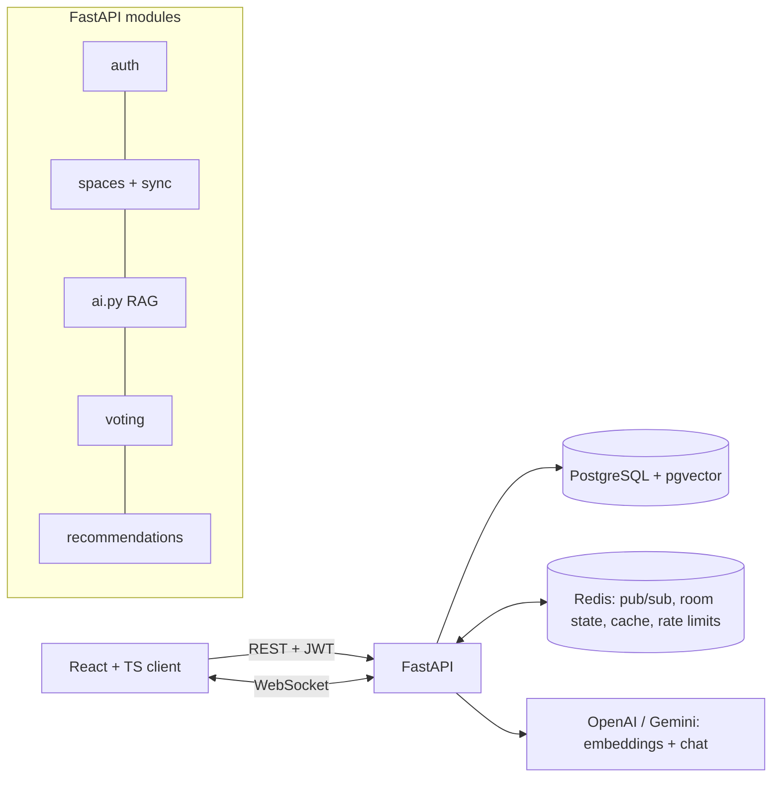
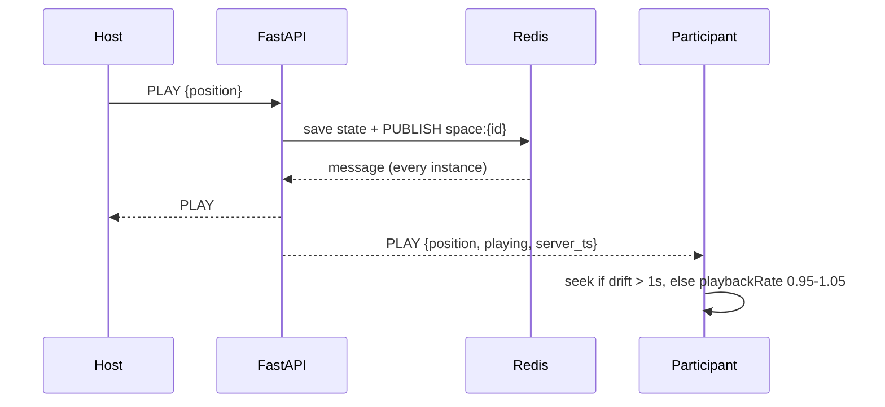

# Netflix AI Watch Spaces

Real-time social streaming: synchronized watch parties, a scene-aware RAG co-pilot with auto-trivia, voting on pre-approved variations, and recommendations.
**Stack:** React + TypeScript (Vite) · FastAPI · PostgreSQL + pgvector · Redis · WebSockets · JWT · Alembic · OpenAI or Gemini.
Video uses open-license films (Big Buck Bunny, Sintel, Tears of Steel) with fictional scene metadata. No Netflix content is used.

## Architecture



## Quick start
```bash
docker compose up -d                       # PostgreSQL (pgvector) + Redis
cp .env.example .env && set -a && . ./.env && set +a    # fill AI key; unset DATABASE_URL/REDIS_URL to use SQLite/in-memory
pip install -r requirements.txt
python seed.py                             # migrates, loads catalog, demo users, space DEMO01 (add --embed to build RAG embeddings)
uvicorn main:app --reload                  # API on :8000, docs on /docs
cd frontend && npm install && npm run dev  # UI on :5173
python -m pytest -q                        # 13 tests (uses a throwaway DB; on PostgreSQL it DROPS the public schema, so use a test database)
```
Migrations: `alembic upgrade head` (also runs automatically on startup), `alembic downgrade -1`, `alembic revision -m "msg"`.

## Demo script (2 browsers: one normal, one incognito)
1. Register two users, or log in as `host@demo.com` and `viewer@demo.com` (password `demo1234`).
2. Host: open a title, click **Host a watch space**. Viewer: join with the invite code or from the lobby.
3. Host presses play and seeks; the viewer follows. Reload the viewer's tab to show the resync.
4. **Chat** and **People** tabs: messages, presence, and "Recommended for this group".
5. **AI** tab: ask "Who made this?" (answered with cited scene IDs), then ask about a scene you haven't reached (refused: spoiler protection).
6. Wait for a scene change: the "Did you know?" trivia banner appears for everyone.
7. **Polls** tab (host): pick a pre-approved variation, both users vote, close it, and see the stored winner. Narrative sets unlock only after their scene.
8. Mark a title as watched, return to Home, and watch the recommendations change.

## REST API (OpenAPI at /docs)
| Area | Endpoints |
|---|---|
| Auth/profile | `POST /auth/register`, `POST /auth/login`, `GET/PUT /me`, `GET /me/history` |
| Catalog | `GET /titles`, `GET /titles/{id}` |
| Spaces | `POST /spaces`, `GET /spaces` (lobby), `POST /spaces/join`, `DELETE /spaces/{id}` |
| Voting | `GET /spaces/{id}/variations`, `GET/POST /spaces/{id}/polls`, `POST /polls/{id}/vote`, `POST /polls/{id}/close` |
| AI | `POST /ai/ask` |
| Recommendations | `POST /activity/watch`, `GET /recommendations`, `GET /spaces/{id}/recommendations` |

## WebSocket reference: `/ws/spaces/{id}?token=JWT`
The user must have joined the space (otherwise close code 4403). Close codes: 4401 bad token, 4404 unknown space. Every server message is `{type, payload, server_ts}`.

| Client → server | Payload | Notes |
|---|---|---|
| `PLAY` / `PAUSE` / `SEEK` | `{position}` | Host only; others get `ERROR` |
| `TIME_UPDATE` | `{position}` | Host heartbeat every 5 s; drives auto-trivia |
| `CHAT_MESSAGE` | `{text}` | Max 500 chars, persisted |
| `REACTION` | `{emoji}` | |
| `PING` | `{}` | Every 15 s, answered with `PONG` |

| Server → client | Payload |
|---|---|
| `SYNC_STATE` | `{position, playing, server_ts, expected}`, sent on connect |
| `PLAY` / `PAUSE` / `SEEK` | `{position, playing, server_ts}` |
| `PRESENCE_JOIN` / `PRESENCE_LEAVE` | `{user, online[]}` / `{user}` |
| `CHAT_MESSAGE` / `REACTION` | `{user, text}` / `{user, emoji}` |
| `AI_TRIVIA` | `{scene_id, text}`, once per scene per space |
| `POLL_OPEN` / `POLL_VOTE` / `POLL_RESULT` | `{id, question, options, kind}` / `{poll_id, tally}` / `{poll_id, winner, tally}` |
| `ERROR` | `{msg}` |

## How the main pieces work
- **Sync:** the host is authoritative. State lives in Redis. A client computes `expected = position + (now - received_at)`. Drift over 1 s causes a seek; smaller drift adjusts `playbackRate`. Clients reconnect with exponential backoff and receive `SYNC_STATE`.
- **RAG (`ai.py`):** chunk (overlap) → embed → pgvector. Query: embed the question, filter `start_sec <= current_time` in SQL (spoiler protection), rank by cosine similarity. Below `RAG_MIN_SCORE` it refuses without calling the LLM. Otherwise only the retrieved chunks, wrapped as untrusted data, go to the LLM, which cites `[S1]`. Answers are cached in Redis for 10 min and rate limited per user. If the provider fails, it falls back to lexical search.
- **Voting:** polls come only from `variation_sets` (no free text). Scene-specific sets are gated by the host's playback position. A unique `(poll_id, user_id)` constraint gives one vote per user (changeable until close). Only space members can vote.
- **Recommendations:** `0.6 × genre similarity + 0.4 × collaborative`, with a cold-start fallback. Cached per user for 10 min and cleared on new activity. Group view = average over everyone connected, restricted to titles nobody has seen.

## Data model (migrations 0001–0006)
users · spaces · space_members · polls · votes · chat · watch_events · titles · scenes · variation_sets · variation_options · kb_chunks (pgvector, PostgreSQL only).

## Known limitations
No refresh-token endpoint (access tokens last 60 min) · no host-transfer or max-participant limit · no admin UI or `/ai/ingest` endpoint (use `python seed.py --embed`) · AI questions go over REST, not WebSocket (`AI_QUESTION`/`AI_ANSWER` events are not implemented) · tested with a single server instance; LLM paths tested with a fake provider · run `alembic upgrade head` once before starting several instances · demo videos need internet access.
